## 2026-10-23 接入 DeepSeek 文本模型

- DeepSeek Harness 的「模型设置」只影响助手本身，不会自动传给 8780 这个 demo。
- demo 新增独立的模型设置：点击首页右上角模型胶囊，选择 DeepSeek，填入 API Key、模型和 Base URL 后保存即可切换。
- 文本生成走 DeepSeek（默认 deepseek-chat），参考图分析与 AI 配图仍走千问；没有千问 Key 时只影响图片能力。
- 配置写入本机 .env.local，不会出现在导出页面里。

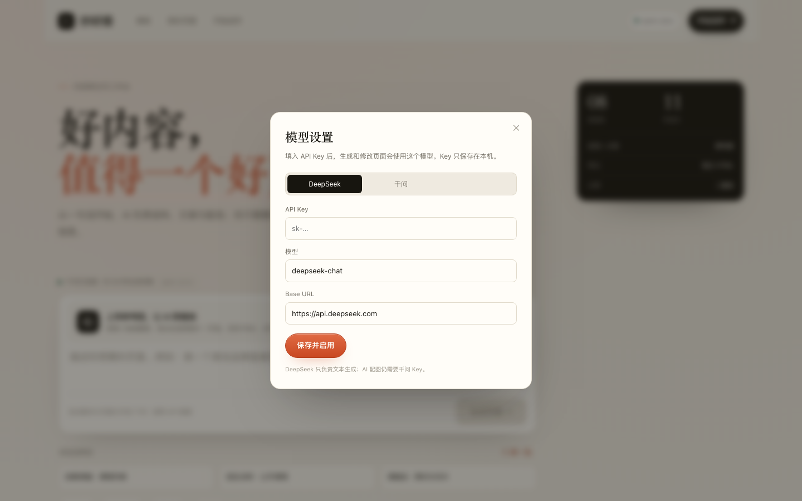

## 2026-10-23 观看页重构：本地播放器 + 真实聊天

- 点播播放器脚本改为本地 /vendor/polyv-player.js，避免 Polyv 远端脚本被网络拦截导致一直停在「播放器加载中」。
- 12:53 的点播视频已能正常加载起播；播放器脚本不再依赖外网 CDN。
- 观看页去掉关注、收藏、评论、点赞、顶部互动按钮、主办方说明和写死的观看人数，只保留标题、作者、播放和聊天。
- 直播聊天接入 polyv-live-watch-sdk：游客授权、历史消息、发送文本消息；SDK 不可用时保留本地输入兜底。
- 手机端底部只留输入框和发送按钮，直播页不再重复堆「直播中」。

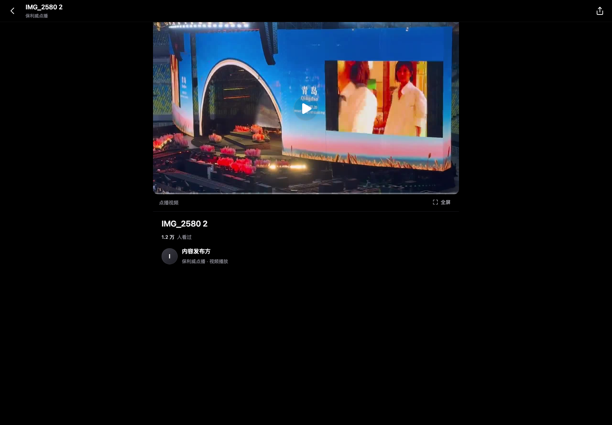
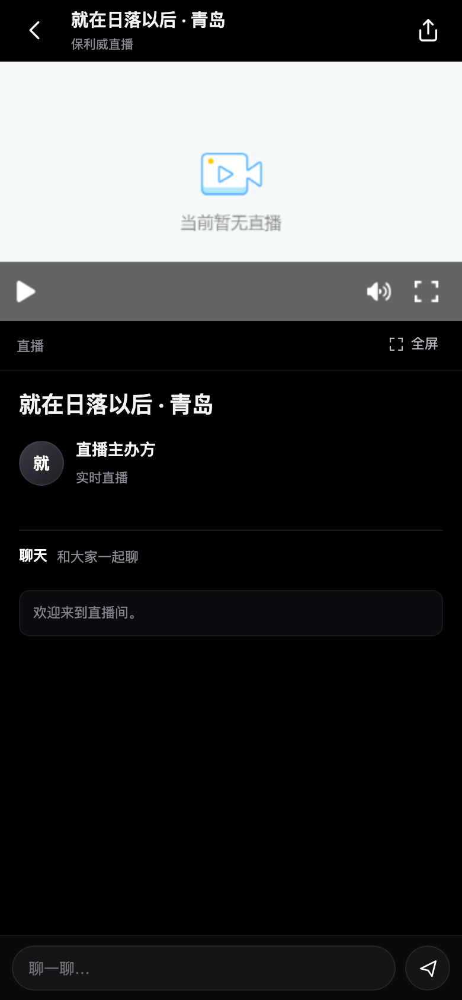
# 抄好搭 Next · AI 驱动的 H5 内容聚合页工作台

按《抄好搭产品需求与实施方案 V2.0》从零实现的新系统。独立工程，不复用原 demo 代码，也不修改原 demo 目录。

核心链路：**一句话生成 → 对话修改 → 手机预览 → 导出 / 分享二维码**。

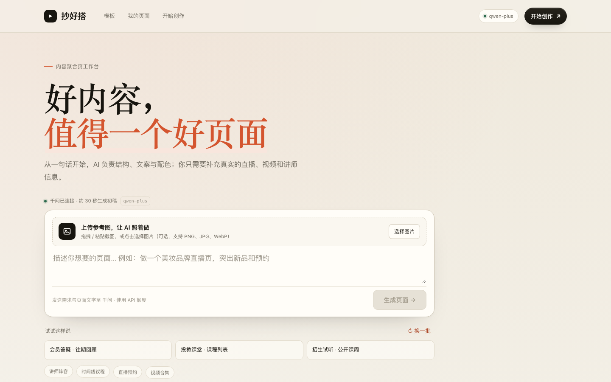

## 运行

需要 Node.js 20+。`start.sh` 会自动寻找可用的 Node（系统 Node 过旧时会使用本机 DSH 内置运行时）。

```bash
./start.sh          # 构建前端并启动 http://127.0.0.1:8780
./stop.sh           # 停止 8780 上的服务
PORT=8790 ./start.sh
```

macOS 也可以双击 `start.command`。后台运行时日志在终端输出里。

千问密钥只从服务端 `.env.local` 读取（已在本机配置，且被 `.gitignore` 忽略）：

```
DASHSCOPE_API_KEY=sk-...
QWEN_MODEL=qwen-plus   # 可选
QWEN_VISION_MODEL=qwen3-vl-plus
QWEN_IMAGE_MODEL=qwen-image-2.1-pro
```

没有配置密钥时，服务端会进入演示模式，返回可编辑的示例结构，并在界面上标明「演示模式」。

## 2026-10-23 公网 HTTPS 分享与点播兜底

- 手机扫码不再使用 http + IP。新增 tunnel.sh：启动 Cloudflare 临时隧道，把 HTTPS 域名写入 PUBLIC_BASE_URL，分享二维码直接编码该域名。
- 微信里不会再出现「该地址为 IP 地址」的安全提示；手机不需要和电脑在同一个 Wi-Fi。
- 隧道地址每次启动可能变化，重新生成二维码即可；旧二维码里的 IP 地址会失效。
- 点播播放器脚本已改为本地托管，并保留加载超时和错误提示。

运行：

```bash
./tunnel.sh
```

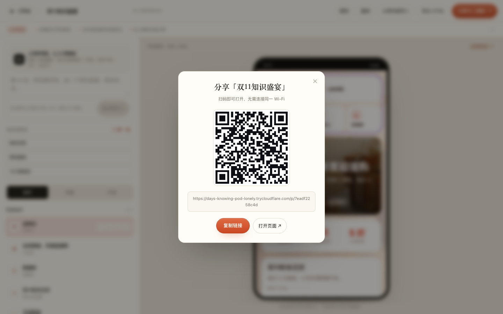
## 2026-10-23 模板先预览、再使用

- 点击模板卡不再直接进入编辑器，也不会写入「我的页面」。
- 打开的是模板预览：左侧显示分类、标签和包含的组件，右侧是 390 宽的真实页面预览，可滚动。
- 只有点击「使用此模板」才会创建页面并进入编辑器；「只看一下」或点遮罩直接关闭。
- Esc 可关闭预览。

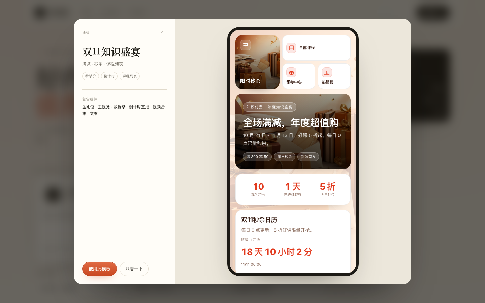
## 2026-10-23 工作台首页视觉升级

- 首屏右侧能力概览改成深色规格卡：大号模板/组件数量 + 保利威、导出、分享三项能力，和浅色正文形成对比。
- 首页加入低饱和暖色环境光与纸张颗粒，输入区保留为唯一主操作。
- 模板区改成深色画廊面板：大标题、场景筛选（全部/活动/课程/品牌）、编号与分类信息。
- 模板卡从等宽三列改成有层级的 12 栅格：双11知识盛宴和长谈作为两张主推大卡，其余模板作为常规卡；筛选后自动回到等宽网格。
- 卡片增加编号、分类、打开动作，悬停时预览上移并出现入口。


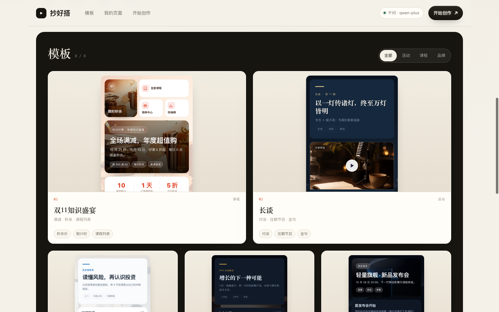

## 2026-10-23 页面背景与有取舍的金刚位

- 8 套模板都补了页面背景图：用与主题匹配的现有素材做低透明度底图，卡片之间能看到环境纹理，同时保证正文可读。风格面板里可以上传、移除背景图，并调整背景强度；导出和分享会把背景图内联。
- 金刚位不再全量铺开，只保留在两套真正需要栏目分流的模板：
  - 双11知识盛宴：bento 大小卡混合，大卡是限时秒杀，三张小卡是课程、领券、榜单
  - 7 天训练营：横向胶囊样式，今日任务 / 课表 / 榜单 / 补课
- 其余 6 套模板不加强行导航：投教课堂、行业峰会、中医讲堂、长谈用文字主视觉，新品发布会和演唱会现场用海报/产品主视觉。
- 模板首屏现在分为：金刚位开场、文字主视觉、产品/海报主视觉三种，不再千篇一律。


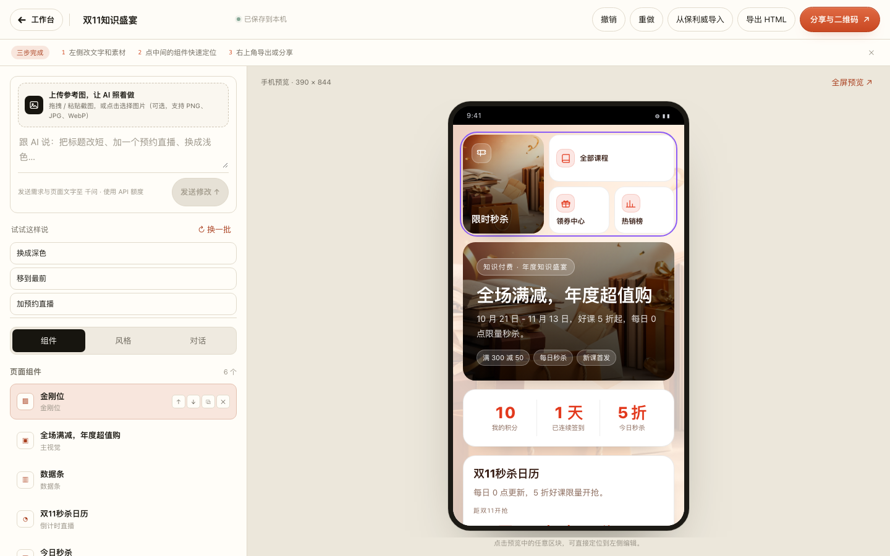
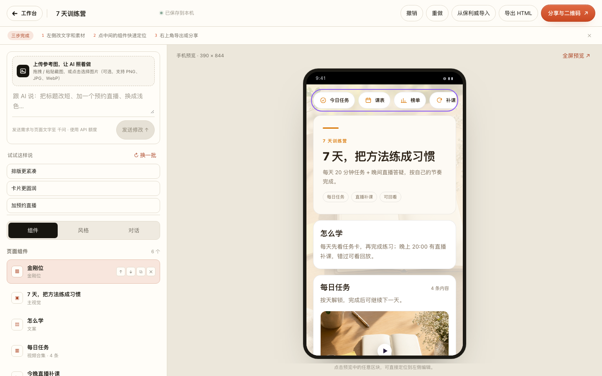

## 2026-10-23 手机扫码分享（局域网）

- 服务默认监听 0.0.0.0，不再只绑定 127.0.0.1。
- 分享链接会优先使用物理网卡的局域网 IP（en0 / Wi-Fi / 有线），避开 VPN、utun 等虚拟网卡；二维码编码的就是这个局域网地址。
- 手机与电脑连同一 Wi-Fi 后，扫码即可打开静态快照；快照里的图片已经内联，不依赖电脑上的额外素材请求。
- 分享弹窗不再写「仅本机可访问」，改为「手机和电脑连同一 Wi-Fi，扫码即可打开」。
- 可以用 PUBLIC_HOST 环境变量强制指定对外地址，例如公司内网域名。


## 2026-10-23 互动数据开关与展示规则

- 直播组件可配置「在看人数」「发布时间」「内容标签」，并分别开关是否显示。
- 视频合集可配置每个视频的「播放量」「时长」「发布时间」「内容标签」，合集上可统一开关这四类数据。
- 展示规则按参考实现：播放量不足 1 万显示整数，达到 1 万按「万」显示并保留一位小数、去掉末尾 .0；在看人数显示为「x 人正在观看」；时长不足 1 小时为 mm:ss，达到 1 小时为 hh:mm:ss；标签最多 2 个、每个最多 6 字；发布时间不足 24 小时显示相对时间，否则显示日期。
- AI 修改页面时会保留这些手动配置，不会因为重新生成而重置开关。

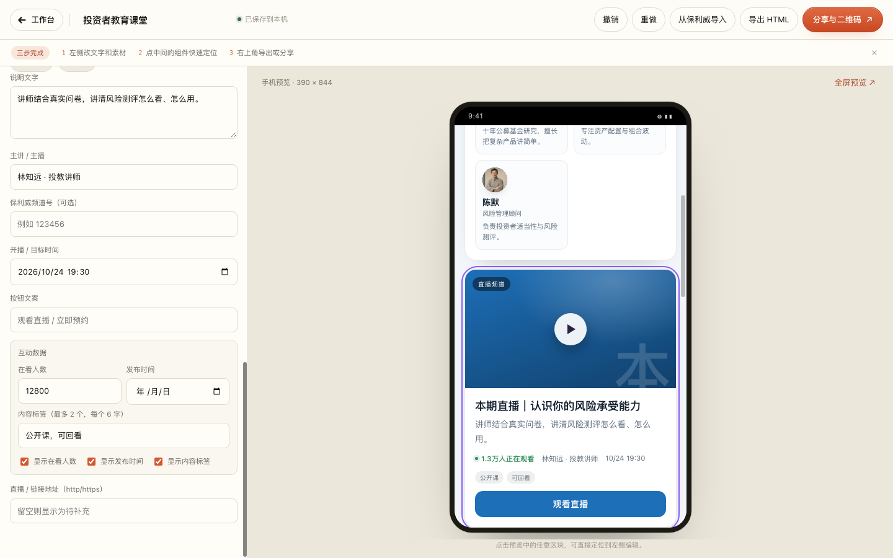
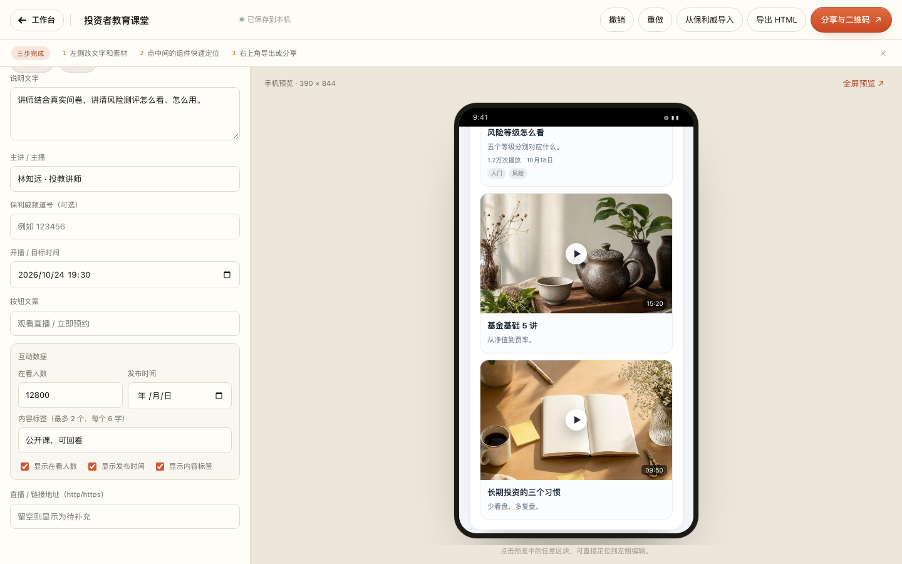

## 2026-10-23 编辑联动与保利威填充

- 左侧组件列表点击任意组件，右侧手机预览会平滑滚动到对应区块，并保留选中描边。
- 「从保利威导入」不再无条件新增直播/合集组件：当前选中的是直播组件时直接填入频道、封面、标题和时间；当前选中的是视频合集时直接追加点播条目。
- 当前组件类型不匹配时，会优先找到页面里已有的直播或视频合集并填入，同时自动选中它；只有页面里完全没有对应组件时才新增。
- 导入弹窗会提前说明这次数据将填到哪里。

## 2026-10-23 观看页 H5 重做与播放修复

- 观看页改成主流 H5 视频结构：顶部固定返回 / 标题 / 分享栏，不再把返回和分享浮在视频中间。
- 点播页：视频、时长/全屏工具条、标题、作者与关注、点赞/分享/收藏/评论、简介。
- 直播页：顶部直播标识、在看人数、作者、互动区，以及底部「聊一聊」输入栏；直播间没有内容时显示官方提示。
- 在 App 内打开观看页时是一条全屏观看页，返回按钮会关闭浮层；独立打开时返回上一页。
- 播不出来主要卡在保利威 Playsafe：修正了 MD5 签名规则（secret + 按 key 排序的 key+value + secret），并去掉凭证接口不接受的额外参数。实测点播视频可以正常播放、进度会走。
- 直链视频加了大号播放按钮，点击即可播放。
- 直播改为直接嵌入保利威纯视频播放器（不走需要登录授权的 SDK），频道开播后即可播放；用户侧不再显示播放条件、加密、凭证等技术说明，失败时只给一句「视频暂时无法播放，请稍后重试」和重试按钮。


## 2026-10-23 新增知识付费模板：双11知识盛宴 / 长谈

- **双11知识盛宴**：促销主视觉、数据条、倒计时日历、带价格/原价/秒杀标签的促销课程列表，以及底部说明。对应参考图里的双十一购课场景。
- **长谈**：深色对谈主视觉、本期视频、三列往期节目、节目介绍。对应参考图里的知识对谈场景。
- 新增 `stats` 数据条组件；合集新增 `sale` 促销列表和 `triple` 三列小卡两种排版。
- 合集条目新增秒杀价、原价、标签、按钮文案字段；直播/倒计时新增按钮文案和倒计时文案。
- 两套模板的图片素材同样是 AI 生成的演示内容，可在封面处手动替换。


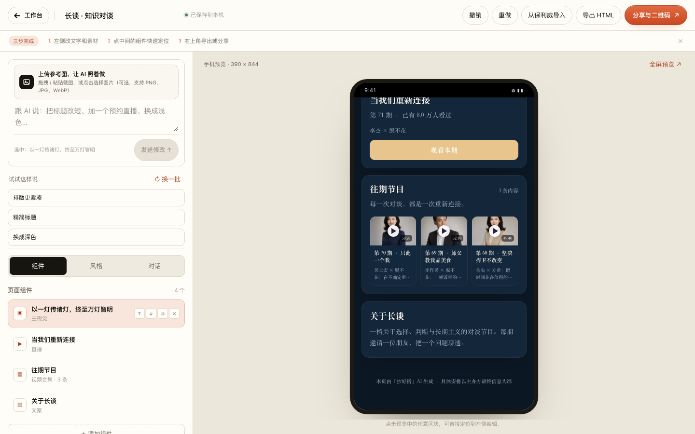

## 2026-10-23 手动替换封面与自动配图

- 主视觉、直播封面、合集条目、讲师头像都可以手动替换：点「上传图片」或把图片直接拖到封面缩略图上，客户端会压缩成 data URL，导出和分享保持自包含。
- 原来的 AI 生图保留，作为手动上传之外的一个选项，不再是被迫的唯一路径。
- 新建页面后会自动根据页面标题、说明和模块内容生成最多 3 张配图：主视觉、直播封面、合集封面。参考图的整体气质只作为风格提示，画面内容按当前文案重新生成。
- 配图在页面打开后异步生成，顶部有「正在生成配图 x / 3」提示，可以继续编辑或中途停止；如果某张封面在生成期间被手动替换，自动结果不会覆盖。
- 参考图仍然用于版式、配色和初始封面裁切；自动配图完成后会替换成与当前页面内容更相关的图片。

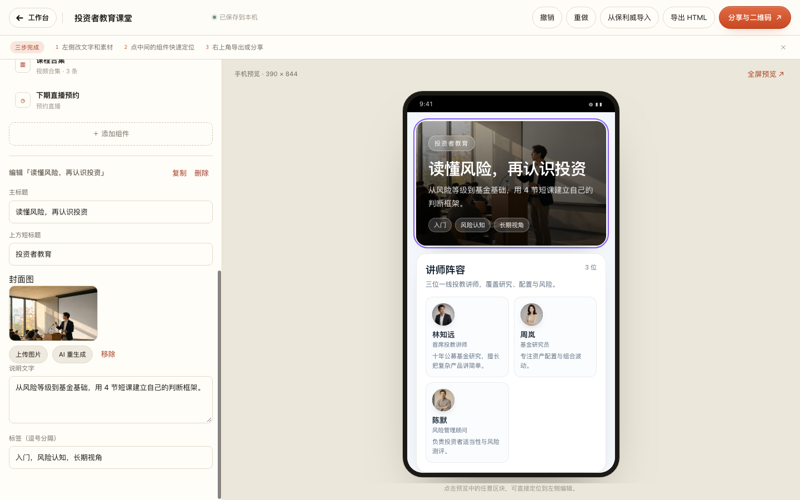
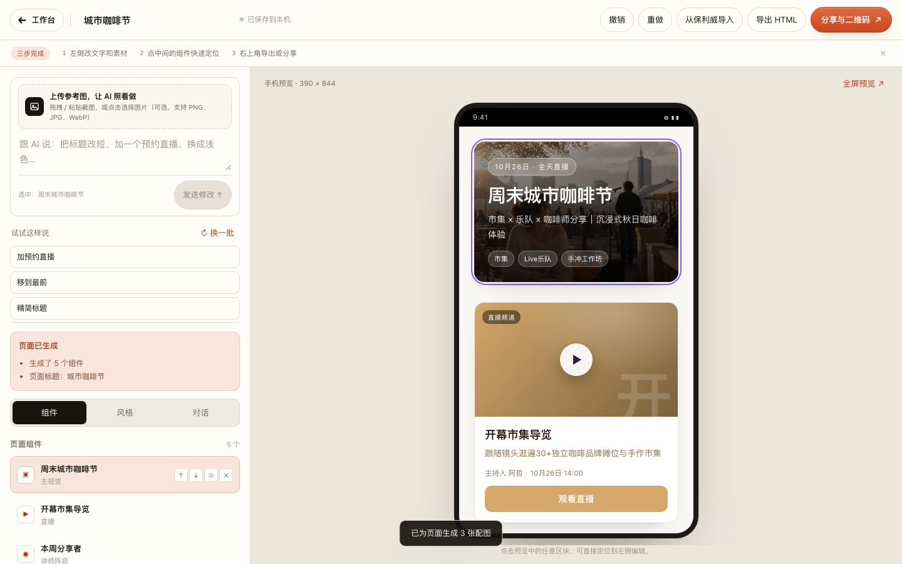

## 2026-10-23 参考图链路与控件溢出修复

- 参考图不再只取文字和色值：视觉模型现在输出 hero 版式（cover/stage/split/brief）、内容模块顺序与列数、卡片质感；生成后按这些结构应用 heroLayout 与合集列数。
- 参考图会被裁成 16:9 头图和三张 16:10 卡片封面，自动填入空封面；导出和分享使用 data URL，保持自包含。
- 新增四种主视觉版式：大图覆盖、舞台居中、上图下文、简洁导览。
- 控件溢出修复：长 VID 会截断而不是撑破面板，封面按钮自动换行，顶部操作区允许折行。

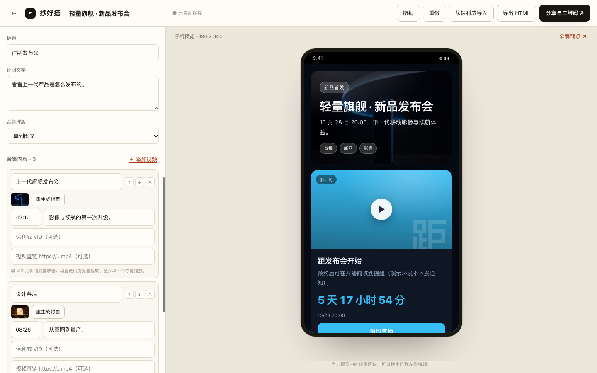

## 2026-10-23 视觉重做与真实素材

- 设计语言重做：纸张底色 + 宋体标题 + 单一陶土色强调，去掉霓虹渐变和发光；工作台改为浅色三栏，手机预览保留深色边框。
- 首页左侧文案与输入，右侧两台设备通过 iframe 实时渲染真实模板，带入场、悬浮动画；模板卡内嵌按 390 宽渲染的缩略页，悬停会向上滚动，不再是纯文字卡片。
- 6 套模板都补了真实素材：6 张 AI 生成的场景图、4 张讲师肖像、2 段 CC0 示例视频，放在 public/media/；套用模板时自动转成 data URL，导出/分享保持自包含。
- 讲师阵容有头像、姓名、头衔、简介；时间线节点可挂真实的保利威 VID 或视频直链。


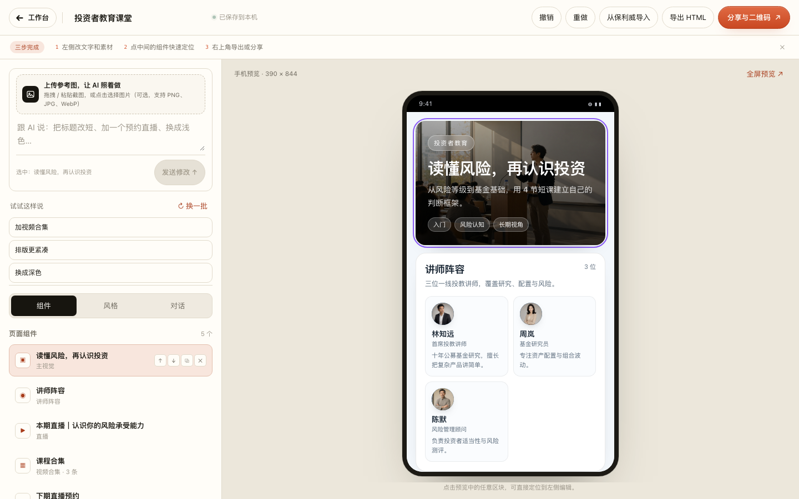
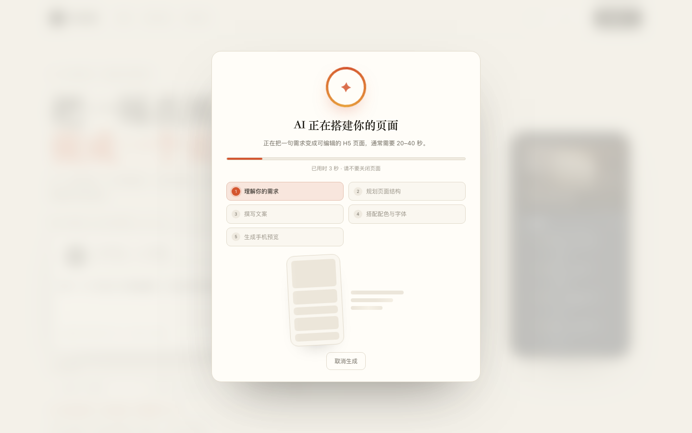

## 已实现（对照 PRD）

| PRD 能力 | 当前实现 |
| --- | --- |
| 一句话生成页面 | 真实千问调用，返回结构化页面（主题、字体、间距、组件）；JSON 解析或校验失败自动重试一次 |
| 参考图生成 | 上传参考截图，qwen3-vl-plus 提取配色/版式/模块，再由文本模型生成同风格页面 |
| AI 封面 | qwen-image-2.1-pro 生成头图与合集封面，压缩后写入页面、预览和导出 |
| AI 对话编辑 | 支持改文案、增删组件、排序、配色、字体、圆角、间距、合集排版；生成改动清单并可撤销 |
| 内置提示词 | 首页 12 条、编辑页 8 条，每次随机 3 条，「换一批」不重复上一批 |
| 行业/场景模板 | 投教课堂、行业峰会、新品发布会、演唱会、7 天训练营、中医讲堂，6 套独立信息结构、组件顺序与视觉 |
| 组件 | 主视觉、文案、直播、预约直播、倒计时直播、视频合集（单列/双列/瀑布流）、讲师阵容（单列/双列）、时间线/议程、链接 |
| 页面风格 | 6 个颜色 token、3 种字体、圆角/边距/间距，4 套配色预设 |
| 手机预览 | 390 × 844 画布；点击预览区块可直接定位到左侧组件 |
| 预览 = 导出 = 分享 | 同一个 `renderPageHTML()` 渲染预览、导出文件和分享快照，避免三套样式 |
| 保存与恢复 | localStorage 自动保存、我的页面列表、删除 |
| 导出 HTML | 单文件导出，样式内联，可直接双击打开 |
| 保利威内容导入 | 直播频道 / 点播视频列表适配，编辑器内搜索、分页、选择导入 |
| 独立观看页 | `/watch` 页面：直播用 live-watch-sdk，点播用 PolyvPlayer，支持回放与 Playsafe |
| 分享与二维码 | 服务端保存静态快照到 `/p/:id`，返回链接并生成二维码 |
| AI 状态 | `/api/status` 返回 provider/model/configured，首页实时展示 |
| 失败保护 | 请求失败保留原页面；无变化时明确提示；改动可撤销 |

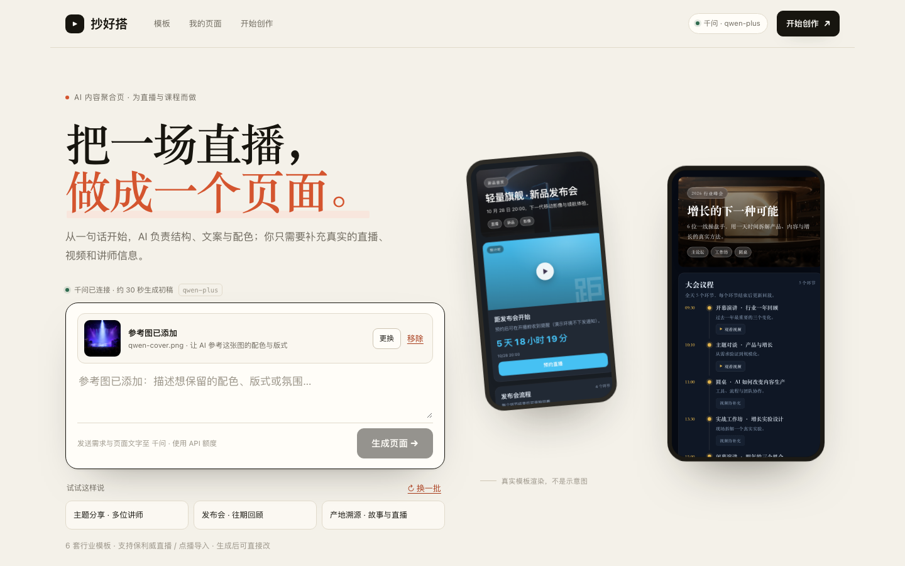


模板示例：行业峰会（时间线与讲师阵容）

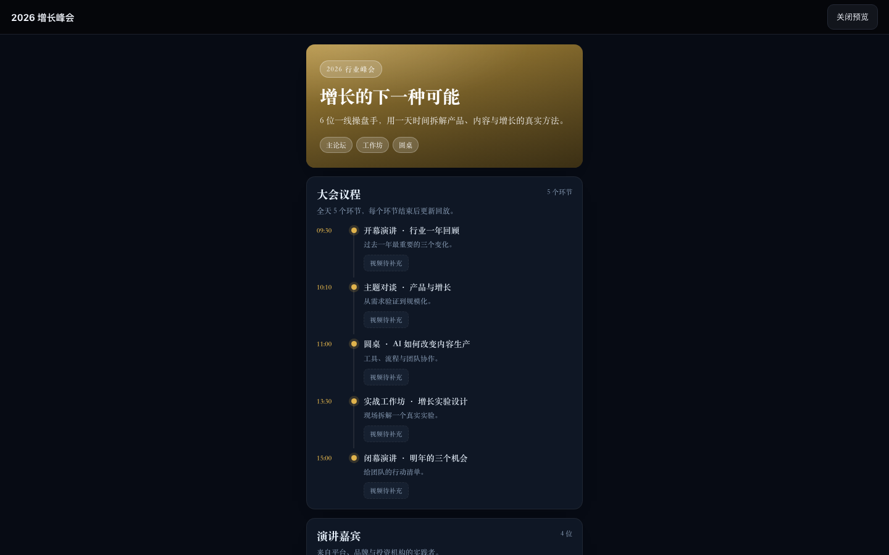
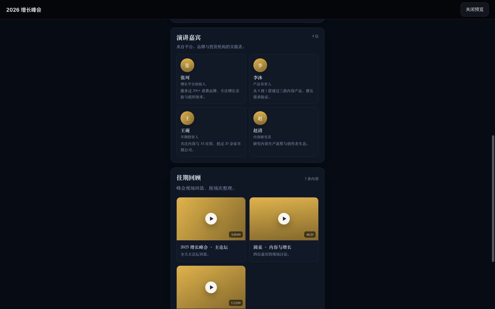

## 技术结构

```
src/
  App.tsx            页面状态、AI 调用、保存、导出/分享
  components/        首页、编辑器、AI 输入区、手机预览、分享弹窗
  render.ts          H5 渲染器（预览 / 导出 / 快照共用）
  templates.ts       4 套场景模板
  diff.ts            改动对比（生成用户可读的改动清单）
  prompts.ts         内置提示词
server/index.mjs     静态服务 + 千问代理 + 分享快照
scripts/build.mjs    esbuild 构建
```

说明：构建使用 esbuild，而不是 Vite。原因是本机 Node 运行时带硬化签名，Vite 依赖的 Rollup 原生模块（`.node`）因 Team ID 不一致无法加载。esbuild 使用独立可执行文件，可以正常构建。

## AI 工作方式

- 默认模型 qwen-plus（可用 `QWEN_MODEL` 覆盖），通过 DashScope OpenAI 兼容接口调用，`response_format=json_object`。
- 生成/修改都要求模型返回**完整页面 JSON**（`summary + page`），服务端用 JSON Schema 约束结构，再做白名单归一化：组件类型、字段长度、颜色、数值范围、URL 协议（仅 http/https）。
- 不执行模型返回的 HTML / CSS / JS；渲染器只消费校验后的数据。
- 修改时把当前页面作为上下文传入，并要求保留未涉及的内容；服务端对比修改前后，前端展示实际改动。
- 模型不会编造真实链接、人数、资质、价格；时间不确定时留空，倒计时显示「待设置开播时间」。
- 参考图分两步：视觉模型先输出设计 brief（配色/版式/模块），文本模型再按 brief 生成页面，避免直接照抄截图内容。
- 每次生成最多两次：第一次失败后会把校验错误回传给模型要求修正；仍失败才返回错误，原页面不变。
- AI 封面走 DashScope 生图接口（qwen-image-2.x 多模态同步接口，旧模型走异步任务），服务端下载后转 data URL，前端压缩到 1024px JPEG 再保存。

## 保利威接入

账号 userId 需通过本机环境变量配置，示例配置不包含真实账号。代码已接好，但列表/回放/播放凭证 API 需要签名密钥才能拿到真实数据：

| 能力 | 接口 | 需要的配置 |
| --- | --- | --- |
| 直播频道列表 | `GET /live/v4/channel/basic/list`（SHA256 签名） | `POLYV_LIVE_APP_ID` + `POLYV_LIVE_APP_SECRET` |
| 点播视频列表 | `GET /v2/video/search-videos`（SHA1 签名） | `POLYV_VOD_USER_ID` + `POLYV_VOD_SECRET_KEY` |
| 回放列表 | `GET /live/v3/channel/playback/get-playback-list` | 直播 AppID/Secret |
| Playsafe Token | `POST https://hls.videocc.net/service/v1/token`（MD5 签名） | 点播 userId + SecretKey |

当前状态可以在编辑器「从保利威导入」里看到：显示本机配置的账号，接口未配置时会明确提示缺少哪个环境变量，不会伪造列表。

配置方式两种：
1. 直接在弹窗里点「配置密钥」填写，保存后立即生效（请求仅限本机同源，密钥只写入服务端 `.env.local`，不进入浏览器存储和导出页）。
2. 手动编辑 `.env.local` 后重启。

（含真实账号信息的截图已移除。）

观看页：`/watch?type=live&channelId=...` 或 `/watch?type=vod&vid=...`。直播 SDK 使用 CDN UMD 版本；点播使用 `player.polyv.net/script/player.js`。未配置 Playsafe 时会尝试自动获取，失败则按普通视频处理。

（含真实账号信息的截图已移除。）

## 尚未实现（明确边界）

- 保利威账号登录/多租户授权；内容库导入代码已接好，但缺少签名密钥，未完成真实账号联调。
- 微信登录、真实预约通知、赞赏统计、学习进度。
- 自定义封面上传与素材库：当前支持参考图上传和 AI 生成封面，未做通用图片素材库。
- 公网发布：分享链接是本机地址，二维码默认只能在同一台机器打开；给同事手机访问需要内网穿透或部署。
- 保利威播放权限：是否可播取决于频道观看条件、视频加密与账号授权，代码不绕过这些限制。
- 多租户、云端项目同步、发布版本管理。

## 验证记录（2026-10-22）

- 真实 千问 生成「美妆新品首发」：5 个组件（主视觉/预约/倒计时/测评合集/文案），深色配色，未编造日期。
- 真实千问对话修改：主标题缩短为「臻美新境·首发」+ 整体改深色高级风，4 个组件与顺序保持不变，耗时约 17 秒。
- 参考图 → 页面：上传舞台图，qwen3-vl-plus 识别出深紫配色与模块顺序，生成同色系 3 个组件，约 22 秒。
- AI 封面：qwen-image-2.1-pro 生成 1024 图（约 22 秒），前端压缩后写入头图，预览与导出同步生效。
- 自动重试：本地 mock 让上游第一次返回非 JSON、第二次返回合法页面，服务端自动重试并成功，日志显示「第 1 次输出未通过校验，自动重试」。
- 界面端到端（千问）：输入需求 → 生成 → 编辑器；分享得到 `/p/` 链接，二维码为 `data:image/png`。
- 桌面 1440×900、移动 390×844 均无横向溢出；控制台无异常。

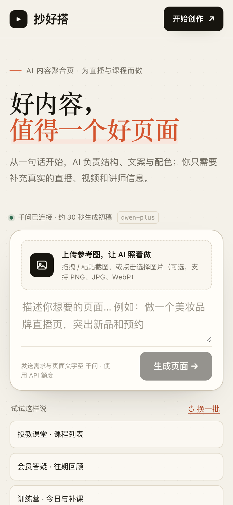
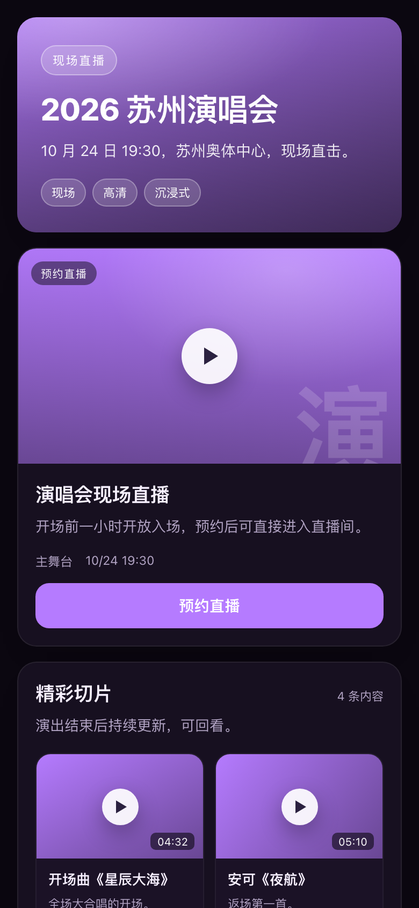
